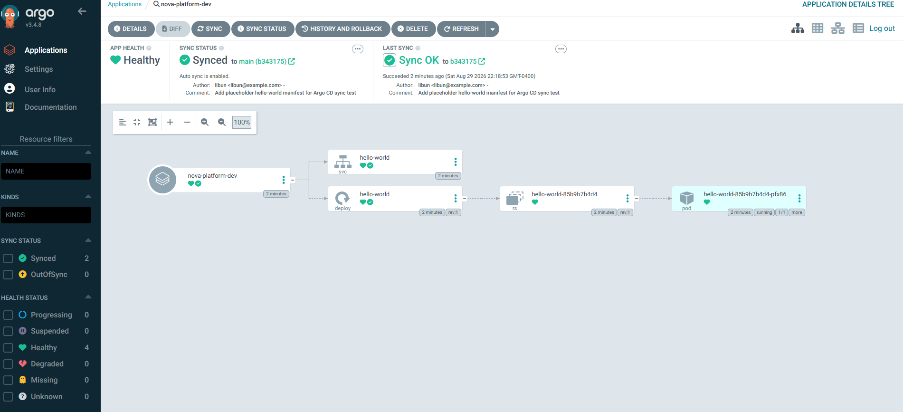
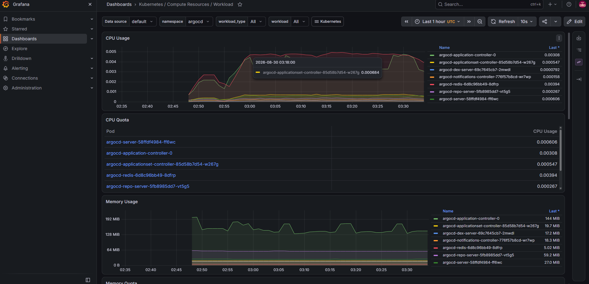

# NovaPlatform

A self-service internal developer platform, built and run entirely on a laptop. NovaPlatform simulates what a platform engineering team builds at a real company — GitOps-driven deployments, reusable Helm charts, namespace-scoped RBAC, cluster monitoring, and a CLI that lets a developer spin up a fully working environment with one command — without needing an AWS account. Infrastructure is provisioned against [LocalStack](https://www.localstack.cloud/) via Terraform, and workloads run on a local [kind](https://kind.sigs.k8s.io/) (Kubernetes-in-Docker) cluster.

## Architecture


Two repos, cleanly separated by concern:
- **[nova-platform](https://github.com/L1bun/nova-platform)** (this repo) — Terraform, cluster bootstrap config, RBAC policy, Argo CD `Application` definitions, and the `nova` CLI. Owned by the platform, changed rarely.
- **[nova-platform-gitops](https://github.com/L1bun/nova-platform-gitops)** — Helm charts and per-environment values files. This is what Argo CD actually watches and syncs from. Changed constantly, as app teams ship.

## What's Implemented

### Infrastructure (Terraform + LocalStack)
A VPC with public/private subnets across two AZs, an Internet Gateway, IAM roles and policies, and S3 buckets for Terraform state and GitOps artifacts — all provisioned against LocalStack's AWS API emulation, cost-tagged (`Team`, `Environment`, `CostCenter`) as they would be in a real account.

### GitOps (Argo CD)
Argo CD watches `nova-platform-gitops` and auto-syncs changes into the cluster, with self-healing enabled — manual `kubectl` drift gets reverted automatically.



### Reusable Helm chart library
Three parameterized charts cover the common workload shapes a platform needs to support:
- **web-service** — Deployment + Service, for anything that serves traffic
- **worker** — Deployment only, for background/queue processing
- **cronjob** — scheduled batch jobs

Each takes per-environment values files, so the same chart deploys differently across `dev`, `staging`, etc.

### Monitoring (kube-prometheus-stack)
Prometheus scrapes cluster and workload metrics; Grafana visualizes them, including live CPU/memory for every deployed workload.



### Per-namespace RBAC
Each namespace gets its own `Role` + `ServiceAccount` + `RoleBinding`, scoping a team's access to only their namespace. Verified directly, not just assumed:

```
kubectl auth can-i get pods -n dev      --as=system:serviceaccount:dev:platform-team-sa       # yes
kubectl auth can-i get pods -n checkout --as=system:serviceaccount:dev:platform-team-sa       # no
kubectl auth can-i get pods -n checkout --as=system:serviceaccount:checkout:checkout-team-sa  # yes
kubectl auth can-i get pods -n dev      --as=system:serviceaccount:checkout:checkout-team-sa  # no
```

### nova CLI
A Typer-based CLI that orchestrates the whole stack — one command creates a namespace, applies RBAC, writes a values file into the GitOps repo, commits and pushes it, and creates the Argo CD Application to deploy it:

```
nova env create staging   # namespace + RBAC + GitOps push + Argo CD Application, end to end
nova env status staging   # pods + Argo CD sync/health status
nova env destroy staging  # tears down cleanly, leaves GitOps history intact for audit
nova env list              # all environments nova manages
nova infra plan / apply    # wraps the Terraform layer
```

## Quickstart

Requires: Docker, WSL2 (or native Linux), kubectl, kind, helm, terraform, Python 3.

```
# 1. Stand up the cluster
kind create cluster --config kind-config.yaml

# 2. Bring up LocalStack and provision infra
docker compose -f docker-compose.localstack.yml up -d
cd terraform/localstack && terraform init && terraform apply
cd ../..

# 3. Install Argo CD
kubectl create namespace argocd
kubectl apply -n argocd --server-side --force-conflicts \
  -f https://raw.githubusercontent.com/argoproj/argo-cd/stable/manifests/install.yaml

# 4. Install monitoring
helm repo add prometheus-community https://prometheus-community.github.io/helm-charts
helm install monitoring prometheus-community/kube-prometheus-stack \
  --namespace monitoring --create-namespace -f monitoring-values.yaml

# 5. Apply RBAC
kubectl apply -f k8s/rbac/teams-rbac.yaml

# 6. Use the CLI
cd cli && python3 -m venv .venv && source .venv/bin/activate && pip install -r requirements.txt
python3 nova.py env create dev
```

## Design Decisions

- **Two repos, not one.** Mirrors how real platform teams separate infra (owned by the platform team) from GitOps content (owned by whoever's shipping). Makes the CLI's `git push` step meaningful rather than cosmetic.
- **Python/Typer over Go/Cobra for the CLI.** Faster iteration without a compile step, at the cost of a single static binary — a reasonable tradeoff for a tool that's evolving quickly, worth revisiting if this were a widely-distributed internal tool.
- **LocalStack over a real AWS account.** Lets the Terraform layer, IAM structure, and cost-tagging strategy be built and demonstrated without any cloud spend, while staying honest about what's simulated vs. real (see below).
- **RBAC verified programmatically, not just applied.** `kubectl auth can-i` checks are part of the workflow, not just the manifests — the point of namespace-scoped RBAC is that it's provably enforced.

## What I'd Do Differently for Production

- Swap the `eks-node` IAM role's trust policy from `ec2.amazonaws.com` to the real EKS OIDC provider trust relationship
- Point Terraform at a real S3 backend (the `tf-state` bucket this project provisions is exactly where it would live) instead of local state
- Replace plaintext values files with sealed-secrets or External Secrets Operator for anything sensitive
- Run Argo CD and Prometheus in HA mode, with persistent storage instead of local/ephemeral
- Add ResourceQuotas alongside the existing RBAC to cap what each team's namespace can consume, not just what it can access
