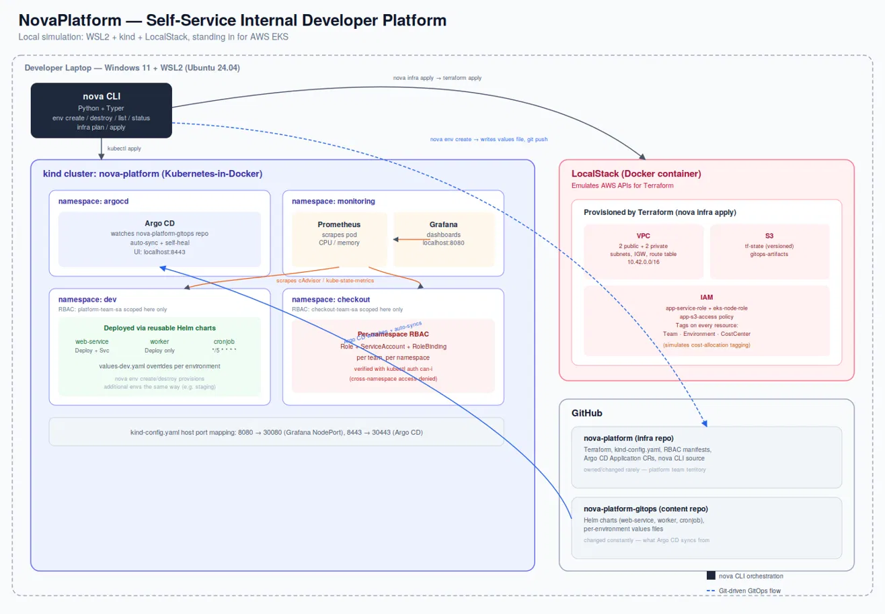
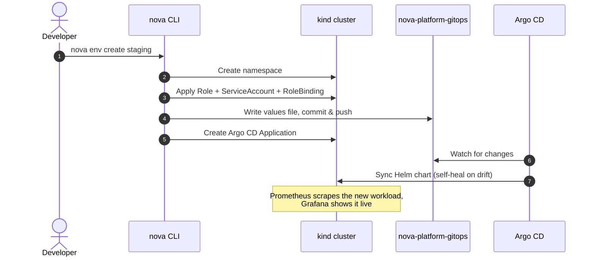

<p align="center">
  
</p>

<p align="center">
  
  
  
  
  
  
  
</p>

<p align="center">
  <a href="#-architecture">Architecture</a> ·
  <a href="#-how-it-works">How it works</a> ·
  <a href="#-features">Features</a> ·
  <a href="#-quickstart">Quickstart</a> ·
  <a href="#-design-decisions">Design decisions</a> ·
  <a href="#-road-to-production">Road to production</a>
</p>

---

NovaPlatform simulates what a platform engineering team builds at a real company: **GitOps-driven deployments, reusable Helm charts, namespace-scoped RBAC, cluster monitoring, and a CLI that spins up a fully working environment with one command.** It needs no AWS account. Infrastructure is provisioned against [LocalStack](https://www.localstack.cloud/) with Terraform, and workloads run on a local [kind](https://kind.sigs.k8s.io/) (Kubernetes-in-Docker) cluster.

```console
$ nova env create staging
✔ namespace created     ✔ RBAC applied     ✔ values pushed to GitOps repo     ✔ Argo CD Application synced
```

## ✨ Highlights

| | |
|---|---|
| ⚡ **One-command environments** | `nova env create` goes from nothing to a deployed, monitored, access-scoped namespace |
| 🔁 **Self-healing GitOps** | Argo CD auto-syncs from Git and reverts manual `kubectl` drift |
| 📦 **Reusable chart library** | `web-service`, `worker`, and `cronjob` charts cover the common workload shapes |
| 🔐 **Provably enforced RBAC** | Per-namespace access, verified with `kubectl auth can-i`, not just applied |
| 📊 **Built-in observability** | Prometheus + Grafana with live CPU/memory for every workload |
| 💸 **Zero cloud cost** | Real Terraform, real IAM structure, real cost tags, all against LocalStack |

---

## 🏛 Architecture



The platform is split across **two repos**, separated by concern:

| Repo | Contains | Owned by | Changes |
|---|---|---|---|
| **[nova-platform](https://github.com/L1bun/nova-platform)** *(this repo)* | Terraform, cluster bootstrap config, RBAC policy, Argo CD `Application` definitions, the `nova` CLI | Platform team | Rarely |
| **[nova-platform-gitops](https://github.com/L1bun/nova-platform-gitops)** | Helm charts and per-environment values files. This is what Argo CD watches and syncs. | App teams | Constantly |

---

## 🔄 How it works

What happens when a developer runs `nova env create staging`:



---

## 🧩 Features

### Infrastructure · Terraform + LocalStack
A VPC with public and private subnets across two AZs, an Internet Gateway, IAM roles and policies, and S3 buckets for Terraform state and GitOps artifacts. Everything is provisioned against LocalStack's AWS API emulation and cost-tagged (`Team`, `Environment`, `CostCenter`) exactly as it would be in a real account.

### GitOps · Argo CD
Argo CD watches `nova-platform-gitops` and auto-syncs changes into the cluster. Self-healing is on, so manual `kubectl` drift gets reverted automatically.


### Reusable Helm chart library

| Chart | Renders | Use it for |
|---|---|---|
| `web-service` | Deployment + Service | Anything that serves traffic |
| `worker` | Deployment | Background and queue processing |
| `cronjob` | CronJob | Scheduled batch jobs |

Each chart takes per-environment values files, so the same chart deploys differently across `dev`, `staging`, and other environments.

### Monitoring · kube-prometheus-stack
Prometheus scrapes cluster and workload metrics, and Grafana visualizes them, including live CPU and memory for every deployed workload.


### Per-namespace RBAC
Each namespace gets its own `Role`, `ServiceAccount`, and `RoleBinding`, scoping a team's access to its own namespace only. This is verified directly, not assumed:

```bash
kubectl auth can-i get pods -n dev      --as=system:serviceaccount:dev:platform-team-sa       # yes
kubectl auth can-i get pods -n checkout --as=system:serviceaccount:dev:platform-team-sa       # no
kubectl auth can-i get pods -n checkout --as=system:serviceaccount:checkout:checkout-team-sa  # yes
kubectl auth can-i get pods -n dev      --as=system:serviceaccount:checkout:checkout-team-sa  # no
```

### `nova` CLI
A Typer-based CLI that orchestrates the whole stack.

| Command | What it does |
|---|---|
| `nova env create <name>` | Namespace + RBAC + GitOps push + Argo CD Application, end to end |
| `nova env status <name>` | Pods plus Argo CD sync and health status |
| `nova env destroy <name>` | Tears down cleanly and leaves GitOps history intact for audit |
| `nova env list` | All environments nova manages |
| `nova infra plan` / `apply` | Wraps the Terraform layer |

---

## 🚀 Quickstart

**Requires:** Docker · WSL2 (or native Linux) · kubectl · kind · helm · terraform · Python 3

**1. Stand up the cluster**
```bash
kind create cluster --config kind-config.yaml
```

**2. Bring up LocalStack and provision infra**
```bash
docker compose -f docker-compose.localstack.yml up -d
cd terraform/localstack && terraform init && terraform apply
cd ../..
```

**3. Install Argo CD**
```bash
kubectl create namespace argocd
kubectl apply -n argocd --server-side --force-conflicts \
  -f https://raw.githubusercontent.com/argoproj/argo-cd/stable/manifests/install.yaml
```

**4. Install monitoring**
```bash
helm repo add prometheus-community https://prometheus-community.github.io/helm-charts
helm install monitoring prometheus-community/kube-prometheus-stack \
  --namespace monitoring --create-namespace -f monitoring-values.yaml
```

**5. Apply RBAC**
```bash
kubectl apply -f k8s/rbac/teams-rbac.yaml
```

**6. Use the CLI**
```bash
cd cli && python3 -m venv .venv && source .venv/bin/activate && pip install -r requirements.txt
python3 nova.py env create dev
```

---

## 🧠 Design decisions

| Decision | Why | Tradeoff |
|---|---|---|
| **Two repos, not one** | Mirrors how real platform teams separate infra (platform-owned) from GitOps content (owned by whoever is shipping). It also makes the CLI's `git push` step meaningful rather than cosmetic. | Changes that span both repos need coordinating |
| **Python/Typer over Go/Cobra** | Faster iteration with no compile step | No single static binary. Worth revisiting if this became a widely distributed internal tool. |
| **LocalStack over real AWS** | The Terraform layer, IAM structure, and cost-tagging strategy can all be built and demonstrated with zero cloud spend | Some pieces are simulated (see below) |
| **RBAC verified programmatically** | `kubectl auth can-i` checks are part of the workflow, because namespace-scoped RBAC only matters if it's provably enforced | — |

---

## 🛣 Road to production

What I'd change before running this for real:

- [ ] Swap the `eks-node` IAM role's trust policy from `ec2.amazonaws.com` to the real EKS OIDC provider trust relationship
- [ ] Point Terraform at a real S3 backend instead of local state. The `tf-state` bucket this project provisions is exactly where it would live.
- [ ] Replace plaintext values files with Sealed Secrets or External Secrets Operator for anything sensitive
- [ ] Run Argo CD and Prometheus in HA mode, with persistent storage instead of local or ephemeral storage
- [ ] Add `ResourceQuota`s alongside RBAC to cap what each team's namespace can *consume*, not just what it can *access*

---

<p align="center">
  Built by <a href="https://github.com/L1bun">Libun Gaade</a> · <a href="https://www.linkedin.com/in/libungaade/">LinkedIn</a>
</p>

<p align="center">
  
</p>
